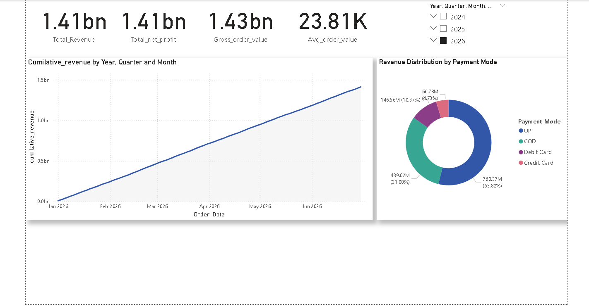
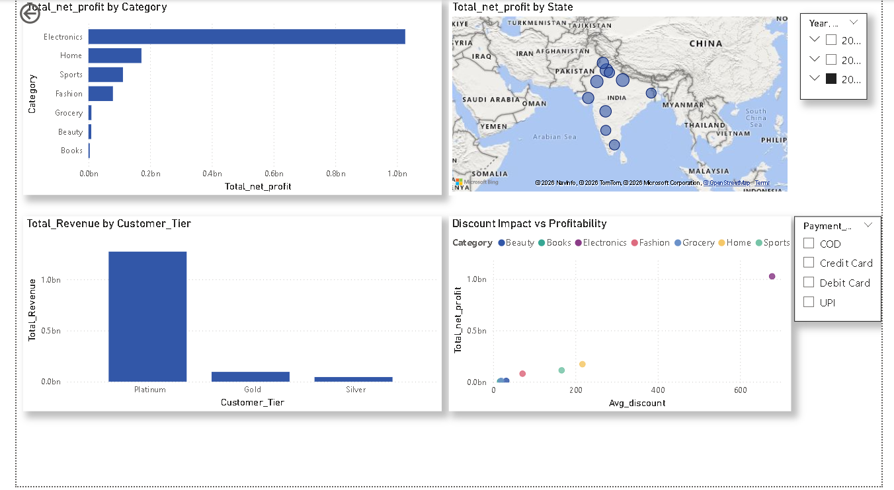

Indian E-Commerce Sales Analysis

Overview:

This projects aims an end to end data analysis solution evaluating transactional performance, customer demographics, and product category trends for an Indian E-commerce bussiness. Utilizing Excel for exploratory data profiling, Sql for relational querying and metrics extraction, and Power BI for interactive visualisation, this projects transforms raw transactional data into actionable bsuiness insights.

Objectives:

\- Analyze sales performance across product categories, customer segments, and geographic regions.

\- Evaluate core business metrics including Total Revenue, Average Order Value (AOV), and Customer Lifetime Value (LTV).

\- Assess fulfillment performance by tracking delivery timelines and order cancellation rates.

\- Build an interactive, executive-ready dashboard to support data-driven decision-making.

Data Architecture:

The analysis is based on a relational dataset containing three core tables:

1\. `customers.csv`: Demographic and registration details for 40,000 customers.

2\. `products.csv`: Catalog information including original price, discounts, ratings, and stock for 2,000 products.

3\. `sales.csv`: Transactional records encompassing 250,000 order lines with shipping costs, coupon discounts, payment modes, and order statuses.

### **PHASE1---**

Data Preparation \& Cleaning (Excel / Power Query):

\[ customers Dataset]

\- Standardization: Capitalized text values in the `Gender` column (`Male`, `Female`) for consistency.

\- Data Type Alignment: Explicitly set data types across all columns, converting `Total\_Spent` to Currency.

\- Data Quality Check: Audited all fields for null values, duplicates, and formatting errors; confirmed zero missing critical fields.

\- Feature Engineering: Added a calculated column `Spent\_Per\_Order` using conditional logic (`if Total\_Orders = 0 then 0 else Total\_Spent / Total\_Orders`) to derive average customer order value while preventing division-by-zero errors.

\-Closed and load data into excel.

\[Products Dataset]

\-Data Type Alignment: Standardized all price-related fields (Original\_Price, Selling\_Price, Discount\_Amount) to Currency format.

\-Data Quality Check: Audited the catalog for null values and pricing anomalies; verified data integrity.

\-Feature Engineering: Created a Discount\_Category conditional column to segment products into distinct promotional bins (No Discount, Low, Moderate, High) to enable granular price-sensitivity analysis in Power BI.

\[Sales Dataset]

\-Data Type Alignment: Converted all monetary fields (Unit\_Price, Order\_Value, Shipping\_Cost, Coupon\_Discount, Total\_Amount) to Currency format.

\-Handling Missing Values: Standardized missing values in text columns by replacing blank entries in Review\_Text with "No review Written" and blank entries in Coupon\_Code with "No code used" to ensure clear visualization filtering.

\-Preserving Statistical Integrity: Retained null values in the Rating column rather than imputing zeros, preventing artificial skewing of average product rating metrics

.

\-Feature Engineering: Created a Delivery\_Days calculated column (Delivery\_Date minus Order\_Date) to measure order fulfillment duration, and derived Net\_Revenue to evaluate true profitability per order line.

### **PHASE2---**

Pillar 1: Revenue \& Profitability Overview

-Executive Summary Metrics: Evaluated overall business financial health by aggregating gross order values, total shipping costs, net collected amounts, and net order profits (Net\_Order\_Profit = Total\_Amount - Shipping\_Cost).

-Payment Mode Efficiency: Grouped transactions by payment method (UPI, Credit Card, Debit Card, COD) to identify total order volume, revenue contribution, and average net profit per mode.

Pillar 2: Product Performance \& Category Breakdown

-Category Profitability: Joined sales and products tables using explicit foreign key mapping (Product\_ID) to evaluate total sales volume and net profit contributions across product categories.

-Discount Impact Analysis: Analyzed how promotional discounting strategies (Low, Moderate, High discount tiers) impact order quantities versus average profit margins per order.

Pillar 3: Customer Segmentation \& Tier Analysis

-Customer Tier Contribution: Utilized COUNT(DISTINCT c.Customer\_ID) combined with table joins across customers and sales to measure unique customer counts, total revenue, and average spend per tier (Gold, Platinum, Silver).

-Geographical Sales Footprint: Identified top-performing cities and states by order volume and net profit contribution using LIMIT and sorting clauses.

Pillar 4: Operational Metrics \& Logistics

-Delivery Performance: Computed average delivery duration (Delivery\_Days), shipping costs, and net profitability grouped by order status (Delivered, Cancelled, Returned, Processing, Shipped) and geographic regions.

Pillar 5: Advanced SQL Analytics (CTEs, Window Functions \& Subqueries)
To demonstrate production-grade analytical engineering, the following advanced queries were engineered to answer complex stakeholder requirements:

1\. Top 3 Most Profitable Products per Category (CTEs \& ROW\_NUMBER())

-Business Intent: Help inventory and merchandising teams identify top performers within every product category.
-SQL Technique: Employed a Common Table Expression (CTE) and ROW\_NUMBER() OVER (PARTITION BY Category ORDER BY Total\_profit DESC) to rank products, filtering for Profit\_rank < 4.

2\. Cumulative Running Total of Revenue (SUM() OVER)

-Business Intent: Track day-by-day financial accumulation over time for executive reporting.
-SQL Technique: Leveraged windowed aggregation (SUM(Net\_Order\_Profit) OVER (ORDER BY Order\_Date)) to compute running totals chronologically.

3\. Month-over-Month Revenue Growth (CTEs \& LAG() Function)

-Business Intent: Measure monthly revenue trajectory and calculate exact variance compared to the previous month.
-SQL Technique: Formatted order dates into monthly buckets (DATE\_FORMAT), aggregated profits in a CTE, and utilized the LAG() window function to bring prior month figures side-by-side for delta calculation.

4\. Local Outliers via Correlated Subqueries ("Super-Customers")

-Business Intent: Identify high-value customers whose individual spend exceeds the average spend within their specific local city.
-SQL Technique: Used a correlated subquery within a HAVING clause (WHERE c1.City = c.City) to dynamically benchmark customers against their local market average.

5\. Customer Value Quartiles (NTILE() \& CASE Statements)

-Business Intent: Dynamically segment the entire customer base into 4 equal behavioral value groups for VIP marketing campaigns.
-SQL Technique: Chained multiple CTEs, applied NTILE(4) OVER (ORDER BY Total\_Spent DESC), and mapped numerical buckets to readable labels (High, Medium High, Medium Low, Low) using conditional CASE logic.

Key Business Insights Summary

-Payment Preferences: UPI and Credit Cards account for the highest transaction velocity and total revenue generation, while Cash on Delivery (COD) shows higher volume but lower average net       profit margins due to return risks.
-Discount Paradox: High discount tiers drive massive unit sales volume (over 109k units), but significantly compress average profit per order compared to low-discount items.
-Geographical Hotspots: Tier-1 and emerging hubs like Madurai and New Delhi dominate net profit generation, offering prime targets for regional fulfillment optimization.
-Customer Concentration: Top-quartile customers (NTILE 1) generate a disproportionate share of lifetime value, validating the need for targeted retention frameworks.

Phase 3: Executive Business Intelligence & Interactive Dashboards (Power BI)
To bridge high-performance data engineering with stakeholder decision-making, the processed relational models were connected to Power BI to develop a two-page, recruiter-ready executive analytics suite.

1. Architecture & Page Structure

Page 1: Executive Summary

-KPI Scorecard Banner: Implemented high-impact top-line cards tracking Total Revenue, Total Net Profit, Gross Order Value (GOV), and Average Order Value (AOV).
-Cumulative Revenue Growth Trend: Built an advanced running-total time-series line chart utilizing custom DAX context transition (CALCULATE, FILTER, ALL) to visualize cumulative revenue expansion across multi-year chronological periods without disruption from standard date hierarchies.  
-Payment Method Breakdown: Visualized channel transaction distribution via a clean donut chart highlighting UPI volume leadership against COD, Credit, and Debit cards.  

Page 2: Market & Customer Analytics

-Category Profitability & Performance: Implemented a descending-sorted bar chart exposing profit drivers, isolating Electronics as the primary bottom-line generator.  
-Geographical Sales Footprint: Configured an interactive spatial bubble map mapped across Indian regional and urban hubs (including New Delhi, Mumbai, and key state nodes).  
-Customer Tier Segmentation: Visualized customer lifetime value concentration across Platinum, Gold, and Silver tiers derived from backend percentile logic.  
-Discount Impact Analysis: Designed a multi-variable scatter plot plotting average discount values against net profitability to evaluate promotional efficiency.

